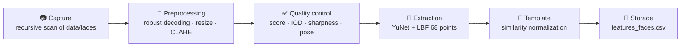

<div align="center">

# 🧬 Facial Biometric Landmark Detection & Feature Extraction

**Lab 2 (Part 1) · Digital Trust & Biometric Access Control**
*SDIA, 2nd year · ENSET Mohammedia*

[](https://www.python.org/)
[](https://opencv.org/)
[](https://numpy.org/)
[](https://pandas.pydata.org/)
[](https://matplotlib.org/)
[](https://jupyter.org/)
[](https://github.com/opencv/opencv_zoo/tree/main/models/face_detection_yunet)

[](#)
[-2a9d8f)](#-pipeline)
[](#-results)
[](#-ethics--privacy)
[](#-ethics--privacy)

</div>

---

## 📌 Overview

This project implements a **batch pipeline** that scans a folder of face images, detects each face, fits **68 facial landmarks**, and turns them into **normalized biometric descriptors** exported to `outputs/features_faces.csv`.

It follows the **biometric enrollment chain** taught in the course (capture → quality control → feature extraction → template → storage). Every file yields exactly one CSV row, with a status code, so failures stay traceable.

**Lab objectives**
1. Observe and understand facial landmark extraction.
2. Build a per-folder batch pipeline and export the descriptors to CSV.

## 🔁 Pipeline



| Stage | Implementation |
|---|---|
| **Capture** | Recursive `os.walk` over `data/faces/`; the first sub-folder is the subject pseudonym; SHA-256 per file (traceability, duplicate detection) |
| **Preprocessing** | Unicode-safe decoding (`np.fromfile` + `cv2.imdecode`), max side 1280 px, CLAHE on luminance |
| **Detection** | YuNet CNN (`cv2.FaceDetectorYN`), confidence ≥ 0.70; the largest face is kept when several are found |
| **Landmarks** | Facemark LBF (`cv2.face`), 68 iBUG 300-W points, with **iterative roll correction** for tilted heads |
| **Template** | Origin at the eye midpoint, horizontal eye line, scale divided by the inter-ocular distance (IOD) → **136 coordinates + 12 geometric ratios** |
| **Quality** | Detector score, IOD ≥ 60 px, sharpness, brightness, contrast, roll/yaw, YuNet–LBF consistency → `quality_ok` and `quality_issues` |
| **Export** | `outputs/features_faces.csv` (UTF-8, 6 decimals), re-read and schema-checked |

Model integrity is verified by **SHA-256** before loading: a tampered or corrupted model is rejected.

## 📂 Project structure

```
tp2_project/
├── tp2_biometrie_v1.0.0.ipynb   # executed notebook (Markdown + commented code)
├── data/
│   └── faces/
│       ├── personne_1/          # one sub-folder per (fictitious) subject
│       └── personne_2/
├── outputs/
│   └── features_faces.csv       # exported descriptors
├── models/
│   ├── face_detection_yunet_2023mar.onnx
│   └── lbfmodel.yaml
├── requirements.txt
└── README.md
```

## ⚙️ Installation

```bash
python -m venv .venv
# Windows:      .venv\Scripts\activate
# Linux/macOS:  source .venv/bin/activate
pip install -r requirements.txt
```

> [!IMPORTANT]
> Install **only** `opencv-contrib-python`: the `cv2.face` module (LBF) is not part of `opencv-python`. If another OpenCV package is already installed, remove it first:
> `pip uninstall -y opencv-python opencv-python-headless opencv-contrib-python`
> On Windows, a `WinError 5` during installation means `cv2.pyd` is locked: shut down the Jupyter kernel / VS Code and try again.

## ▶️ Usage

1. Put face images (`.jpg`, `.jpeg`, `.jfif`, `.png`, `.bmp`, `.tif`, `.webp`, `.avif`) in `data/faces/<subject>/`.
2. Run the whole notebook:

```bash
jupyter nbconvert --to notebook --execute --inplace tp2_biometrie_v1.0.0.ipynb
```

Or open it in Jupyter / VS Code and use **Restart & Run All**. Missing models are downloaded automatically, then checked against their SHA-256 hash.

## 🧾 Output: `features_faces.csv`

One row per file, 176 columns:

| Group | Columns |
|---|---|
| Identification & traceability | `sample_id`, `subject_id`, `file_relpath`, `image_sha256`, `status`, `error_msg`, `is_duplicate`, `pipeline_version`, `processed_at_utc`, `proc_time_ms` … |
| Quality | `det_score`, `n_faces_detected`, `iod_px`, `roll_deg`, `yaw_index`, `sharpness`, `brightness`, `contrast`, `lmk_consistency`, `quality_ok`, `quality_issues` |
| Geometric ratios (unitless) | `face_width`, `face_height`, `face_aspect`, `nose_length`, `nose_width`, `mouth_width`, `mouth_open_ratio`, `eye_r_ear`, `eye_l_ear`, `brow_eye_dist`, `jaw_face_ratio`, `symmetry_index` |
| Normalized landmarks | `lmk_00_x`, `lmk_00_y` … `lmk_67_x`, `lmk_67_y` |

| `status` | Meaning |
|---|---|
| `OK` | landmarks extracted, descriptors computed |
| `FTA_NO_FACE` | no face above the detection threshold (*Failure To Acquire*, ISO/IEC 19795-1) |
| `FTA_LANDMARKS` | face found but landmark fitting failed |
| `ERROR_DECODE` | unreadable or corrupted file |
| `SKIPPED_NOT_IMAGE` | not an image extension |
| `ERROR_UNEXPECTED` | unexpected exception (logged); the batch continues |

## 📊 Results

Results on 6 AI-generated images (2 fictitious subjects × 3):

| Metric | Value |
|---|---|
| Successful extractions | 6 / 6 |
| Failure To Acquire (FTA) | **0 %** |
| Images passing all quality checks | 3 / 6 (others: low resolution, IOD 50–53 px) |
| Detection score | 0.945 – 0.955 |
| YuNet–LBF consistency | ≤ 0.071 IOD |
| Processing time | 20 – 103 ms / image |
| Invariance test: mean shift, raw coordinates | 0.615 IOD |
| Invariance test: mean shift, **normalized** coordinates | **0.018 IOD** |

The invariance test applies rotation, scaling, translation, darkening and blur to each subject's reference image. Normalization reduces the mean landmark shift by about **34×**. The residual comes from LBF fitting noise, i.e. intra-class variability.

> [!NOTE]
> The 1:1 comparison section (genuine vs. impostor distances, FAR/FRR, EER) is **illustrative only**. A handful of images gives no statistical significance, and 68-point geometry is weakly discriminative compared with deep face embeddings.

## 🔐 Ethics & privacy

Facial landmarks are **biometric data**, which are sensitive personal data under Moroccan **Law 09-08**, supervised by the **CNDP**.

- **AI-generated faces only**: to comply with the regulations in force, every image in `data/faces/` is synthetic and depicts no real person. No real biometric data is collected or processed.
- **Data minimization**: the CSV holds geometric descriptors and pseudonyms only, never images or civil identity.
- **Local processing**: models run offline, with no third-party service (in line with CNDP deliberation No. 478-2013 and NIST SP 800-63B-4).
- **Template protection**: in a real deployment, the CSV would have to be encrypted at rest and protected according to ISO/IEC 24745 (irreversibility, revocability, unlinkability).

## ⚠️ Limitations

- Normalization corrects in-plane rotation (roll) only, not yaw or pitch; fitting fails beyond about 40° of tilt (flagged as `landmark_fit`).
- The LBF model was trained on 300-W (mostly frontal faces), so it may be biased by age, skin tone, veil or glasses.
- There is **no presentation attack detection** (ISO/IEC 30107): a printed photo yields valid landmarks. Do not use this pipeline alone for access control.

## 📚 References

1. A. Ouaguid, *Confiance numérique et accès biométrique*, course notes, ENSET Mohammedia, 2026.
2. W. Wu, H. Peng, S. Yu, *YuNet: A Tiny Millisecond-level Face Detector*, Machine Intelligence Research, 2023. [Model](https://github.com/opencv/opencv_zoo/tree/main/models/face_detection_yunet)
3. S. Ren, X. Cao, Y. Wei, J. Sun, *Face Alignment at 3000 FPS via Regressing Local Binary Features*, CVPR 2014. [Trained model](https://github.com/kurnianggoro/GSOC2017)
4. C. Sagonas et al., *300 Faces in-the-Wild Challenge*, ICCV Workshops 2013.
5. T. Soukupová, J. Čech, *Real-Time Eye Blink Detection using Facial Landmarks*, CVWW 2016.
6. ISO/IEC 19795-1:2021 · ISO/IEC 24745:2022 · ISO/IEC 30107-3:2023 · NIST SP 800-63B-4.
7. Moroccan Law 09-08 · CNDP deliberation No. 478-2013.
8. Input images: AI-generated faces (*tool and generation date to be specified*).

## 👤 Author

**[Zoubeir Aouchar]** · SDIA, ENSET Mohammedia · Individual academic work, 2026.
