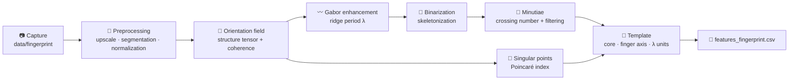

<div align="center">

# 🧬 Multimodal Biometric Keypoint Extraction: Face & Fingerprint

**Lab 3 (Part 2) · Digital Trust & Biometric Access Control**
*SDIA, 2nd year · ENSET Mohammedia · follow-up of Lab 2*

[](https://www.python.org/)
[](https://opencv.org/)
[](https://scikit-image.org/)
[](https://numpy.org/)
[](https://pandas.pydata.org/)
[](https://matplotlib.org/)
[](https://github.com/Kaggle/kagglehub)
[](https://jupyter.org/)

[](#)
[](#-pipeline)
[-orange)](https://www.kaggle.com/datasets/ruizgara/socofing)
[](#-ethics--privacy)

</div>

---

## 📌 Overview

Building on Lab 2, this project extends the face landmark pipeline with a **second biometric modality: fingerprints**. Both modalities share the same batch engine: recursive folder scan, one CSV row per file, normalized status codes, quality flags and SHA-256 traceability.

For each fingerprint, the notebook extracts **minutiae** (ridge endings and bifurcations) and **singular points** (core, delta), builds a **normalized template**, and exports it to `outputs/features_fingerprint.csv`.

**Lab objectives**
1. Build on Lab 2 and add fingerprint processing to the existing pipeline.
2. Observe and understand keypoint (minutiae) extraction on fingerprints.
3. Process every folder in batch and export normalized descriptors to CSV.

## 🔁 Continuity with Lab 2

| Lab 2 component | Reuse in Lab 3 |
|---|---|
| Recursive scan, one sub-folder per subject | `list_files` generalized (configurable extensions, SOCOFing `.BMP`) |
| One row per file, `OK` / `FTA_*` / `ERROR_*` / `SKIPPED_*` statuses | Same convention, plus `FTA_NO_FINGER`, `FTA_NO_RIDGES`, `FTA_FEW_MINUTIAE` |
| SHA-256 of files and models | Unchanged |
| `quality_ok` + explicit `quality_issues` | Same logic, fingerprint-specific criteria |
| Similarity normalization (IOD = 1) | Origin = **core**, axis = **dominant ridge orientation**, unit = **ridge period λ** |
| Invariance test + FAR/FRR/EER illustration | Reused, with a real minutiae matcher |
| Face module | Kept as is; still produces `features_faces.csv` when `data/faces/` holds images |

## 🔁 Pipeline



| Stage | Implementation |
|---|---|
| **Frame removal** | The grey/black capture border of SOCOFing images is replaced by background (4 px) to avoid spurious minutiae |
| **Upscaling** | SOCOFing images (~96×103 px) resized ×3 so that ridges span several pixels |
| **Segmentation** | Local variance mask, largest component; obliterated areas stay outside the mask |
| **Orientation & coherence** | Structure tensor of image gradients (Bazen & Gerez, 2002) |
| **Ridge period λ** | Block projection orthogonal to the ridges, median peak spacing |
| **Enhancement** | Oriented Gabor filter bank, 16 orientations (Hong et al., 1998) |
| **Skeleton** | Binarization + Zhang–Suen thinning (`skimage.morphology.skeletonize`) |
| **Minutiae** | Crossing number (1 = ending, 3 = bifurcation); border, short-spur and close-pair filtering |
| **Singular points** | Poincaré index on the block orientation field (core +180°, delta −180°) |
| **Template** | Intrinsic frame (core, dominant ridge orientation, λ); global counts, 4 normalized histograms, top-30 minutiae `(x, y, θ, type)` |
| **Quality** | Foreground ratio, orientation coherence, contrast, ridge period, minutiae count → `quality_index`, `quality_ok`, `quality_issues` |

## 📂 Project structure

```
tp3_project/
├── tp3_biometrie_v1.0.0.ipynb      # executed notebook (Markdown + commented code)
├── data/
│   ├── fingerprint/                 # SOCOFing subset, one sub-folder per subject
│   │   ├── sujet_001/
│   │   └── ...
│   ├── faces/                       # (optional) AI-generated faces from Lab 2
│   └── socofing_manifest.csv        # provenance log of the downloaded files (source, SHA-256, date)
├── outputs/
│   ├── features_fingerprint.csv
│   └── features_faces.csv           # only if data/faces/ holds images
├── models/                          # YuNet + LBF (face module, SHA-256 checked)
├── requirements.txt
└── README.md
```

## ⚙️ Installation

```bash
python -m venv .venv
# Windows:      .venv\Scripts\activate
# Linux/macOS:  source .venv/bin/activate
pip install -r requirements.txt
```

> [!IMPORTANT]
> Install **only** `opencv-contrib-python` (the face module needs `cv2.face`). Uninstall `opencv-python` / `opencv-python-headless` first if present.

## ▶️ Usage

1. Fingerprints are fetched **file by file** from [SOCOFing](https://www.kaggle.com/datasets/ruizgara/socofing) by the notebook itself (section 2 bis, `kagglehub`), so the full 830 MB archive is never downloaded. By default it takes 3 subjects × 4 versions of the left index finger (`Real`, `CR`, `Obl`, `Zcut`); edit `SOCO_SUBJECTS` / `SOCO_FINGER` to change the selection. If Kaggle asks for authentication, put your API token in `~/.kaggle/kaggle.json` (or set `KAGGLE_USERNAME` / `KAGGLE_KEY`), never in the notebook. Each file is checked and logged with its SHA-256 in `data/socofing_manifest.csv`.
2. Optionally, copy the Lab 2 faces into `data/faces/`.
3. Run the whole notebook:

```bash
jupyter nbconvert --to notebook --execute --inplace tp3_biometrie_v1.0.0.ipynb
```

## 🧾 Output: `features_fingerprint.csv`

One row per file:

| Group | Columns |
|---|---|
| Identification & traceability | `sample_id`, `subject_id`, `file_relpath`, `image_sha256`, `status`, `error_msg`, `is_duplicate`, `pipeline_version`, `processed_at_utc`, `proc_time_ms`, `img_width`, `img_height` |
| SOCOFing metadata | `finger_label`, `alteration` (`Real`, `CR`, `Obl`, `Zcut`), `upscale_factor` (gender deliberately **not** exported) |
| Quality | `foreground_ratio`, `ridge_contrast`, `coherence_mean`, `wavelength_px`, `wavelength_proc_px`, `n_wave_blocks`, `n_minutiae`, `quality_index`, `quality_ok`, `quality_issues` |
| Singular points | `n_cores`, `n_deltas`, `pattern_class`, `ref_type`, `ref_angle_deg` |
| Global descriptors | `n_endings`, `n_bifurcations`, `bifurcation_ratio`, `minutiae_density`, `radius_mean`, `radius_std` |
| Histograms (sum = 1) | `dir_hist_0..7`, `radial_hist_0..4`, `sector_hist_0..7`, `ofield_hist_0..7` |
| Top-30 minutiae | `mnt_00_x`, `mnt_00_y`, `mnt_00_theta`, `mnt_00_type` … `mnt_29_*` (λ units, NaN-padded) |

## 🔐 Ethics & privacy

- **Faces (Lab 2)**: AI-generated, no real person.
- **Fingerprints (Lab 3)**: subset of **SOCOFing** (Shehu et al., 2018), a public research dataset of 600 adult subjects released for **non-commercial use** (CC BY-NC-SA 4.0). It is used here for teaching only and cited.
- **Data minimization**: the subject's gender, present in SOCOFing file names, is not exported.
- **Template sensitivity**: minutiae templates can be used to **reconstruct a fingerprint image** (Cappelli et al., 2007). The CSV should therefore be encrypted at rest and protected according to ISO/IEC 24745. Local storage and 1:1 authentication are preferred, in line with Moroccan Law 09-08 and CNDP deliberation No. 478-2013.

## ⚠️ Limitations

- SOCOFing images are tiny (~96×103 px); upscaling adds no information.
- Genuine pairs compare a finger with its own **synthetic** alterations, not with a second real capture.
- The rigid minutiae matcher (O(n²·m²)) ignores elastic distortion; production systems use MCC or deep descriptors.
- `quality_index` is a heuristic, not the certified NIST NFIQ 2 score.
- There is **no presentation attack detection** (ISO/IEC 30107): gelatin or silicone fakes yield valid minutiae.

## 📚 References

1. A. Ouaguid, *Confiance numérique et accès biométrique*, course notes, ENSET Mohammedia, 2026.
2. Y. I. Shehu, A. Ruiz-Garcia, V. Palade, A. James, *Sokoto Coventry Fingerprint Dataset*, [arXiv:1807.10609](https://arxiv.org/abs/1807.10609), 2018.
3. L. Hong, Y. Wan, A. K. Jain, *Fingerprint Image Enhancement: Algorithm and Performance Evaluation*, IEEE TPAMI 20(8), 1998.
4. A. M. Bazen, S. H. Gerez, *Systematic Methods for the Computation of the Directional Fields and Singular Points of Fingerprints*, IEEE TPAMI 24(7), 2002.
5. M. Kawagoe, A. Tojo, *Fingerprint Pattern Classification*, Pattern Recognition 17(3), 1984.
6. T. Y. Zhang, C. Y. Suen, *A Fast Parallel Algorithm for Thinning Digital Patterns*, Communications of the ACM 27(3), 1984.
7. D. Maltoni, D. Maio, A. K. Jain, J. Feng, *Handbook of Fingerprint Recognition*, 3rd ed., Springer, 2022.
8. R. Cappelli, A. Lumini, D. Maio, D. Maltoni, *Fingerprint Image Reconstruction from Standard Templates*, IEEE TPAMI 29(9), 2007.
9. S. Yoon, J. Feng, A. K. Jain, *Altered Fingerprints: Analysis and Detection*, IEEE TPAMI 34(3), 2012.
10. ISO/IEC 19794-2 · ISO/IEC 29794-4 · ISO/IEC 19795-1 · ISO/IEC 24745 · ISO/IEC 30107-3 · Moroccan Law 09-08 · CNDP deliberation No. 478-2013.
11. Lab 2 notebook (`tp2_biometrie_v1.0.0.ipynb`) and its references (YuNet, LBF, 300-W).

## 👤 Author

**Zoubeir Aouchar** · SDIA, ENSET Mohammedia · Individual academic work, 2026.
